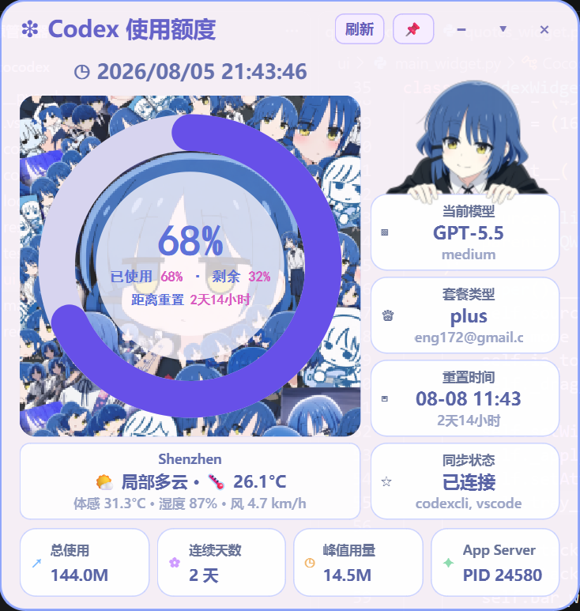

# Cocodex

自己做的一个 Codex 监视器，也是一个二次元桌面小部件，纯粹消遣娱乐用。依赖 VS Code 的 Codex 插件或 Codex CLI，不需要 ChatGPT 客户端。



## 能做什么

- 在状态面板中查看 Codex 额度、连接状态和天气。
- 在面板与桌面角色之间切换，根据本地 Codex 会话事件展示角色状态。
- 支持拖动窗口、窗口置顶、隐藏到系统托盘和台词气泡。

## 运行

当前 Codex 插件查找逻辑和打包脚本主要面向 Windows。使用支持代码中类型注解的 Python 3.10 或更新版本，在项目根目录执行：

```powershell
python -m venv .venv
.\.venv\Scripts\Activate.ps1
python -m pip install -r requirements.txt
python main.py
```

需要已安装并登录的 Codex CLI 或 VS Code Codex 插件。程序优先查找 PATH 中的 `codex`，再查找用户目录下 `.vscode/extensions/openai.chatgpt-*/bin/windows-x86_64/codex.exe`；会话状态来自 `~/.codex/sessions/` 中的日志。

### 角色资源

`resources/` 被 Git 忽略，当前仓库没有包含完整角色素材。若要显示完整界面和动画，需要另行放入对应资源，主要路径包括：

- `resources/bar/lean.png`、`resources/bar/ring.png`：面板图片。
- `resources/wait/`：等待动画 PNG 帧。
- `resources/waitings/`：各待机动作子目录。
- `resources/respones/`：各状态响应动作子目录，目录名沿用代码中的拼写。

天气显示需要联网。仅安装 Python 依赖并不包含 Codex 本体和角色素材。

## 目录

| 路径 | 内容 |
| --- | --- |
| `main.py` | 程序入口 |
| `ui/` | 主窗口、额度面板、角色动画和气泡控件 |
| `core/start_codex_server.py` | 通过本地 Codex app-server 读取状态与额度 |
| `core/respone_from_watch.py` | 监听 Codex 会话日志和解析角色状态 |
| `core/get_weather.py` | 天气查询 |
| `paths.py` | 开发与打包模式下的路径处理 |
| `logs/` | 台词文件和运行缓存 |
| `build_exe.py` | Windows 打包脚本 |

## 打包

准备好 `resources/` 后，在项目根目录执行：

```powershell
python -m pip install pyinstaller
python build_exe.py
```

输出目录为 `dist/CocoDex/`。PyInstaller 不在运行依赖清单中，需要单独安装。

## 许可

代码使用 [MIT License](LICENSE)。
